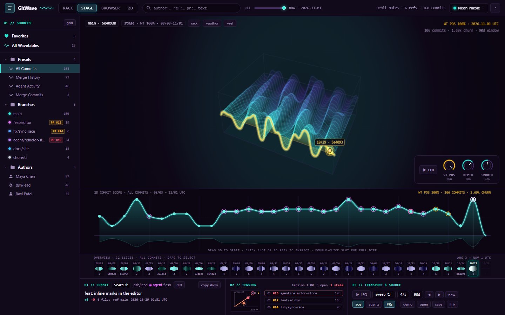
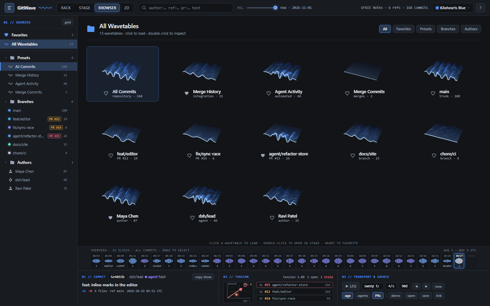
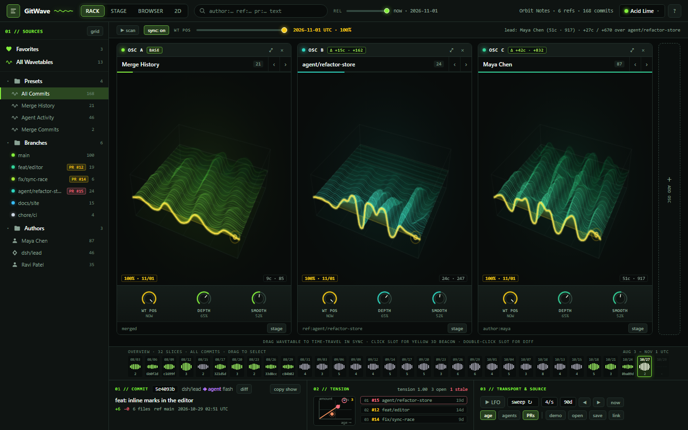
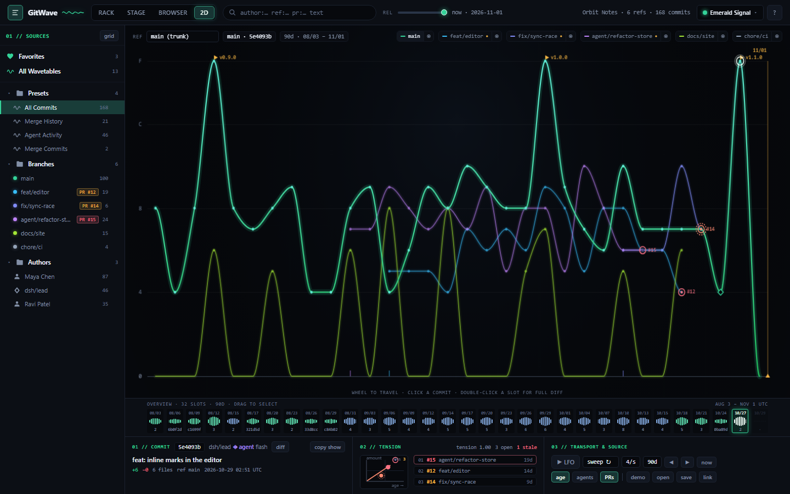
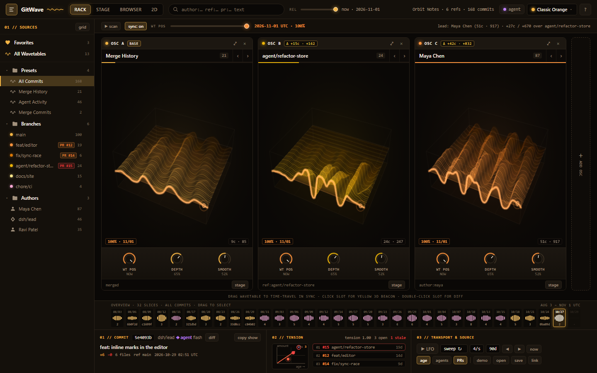
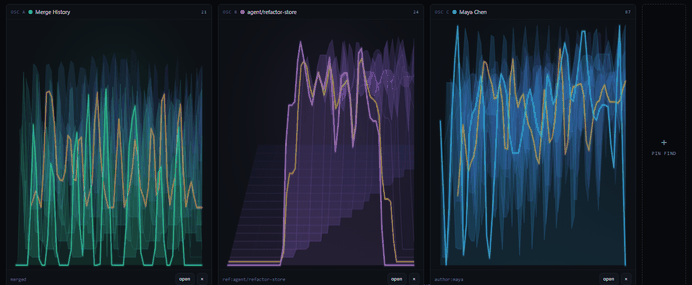
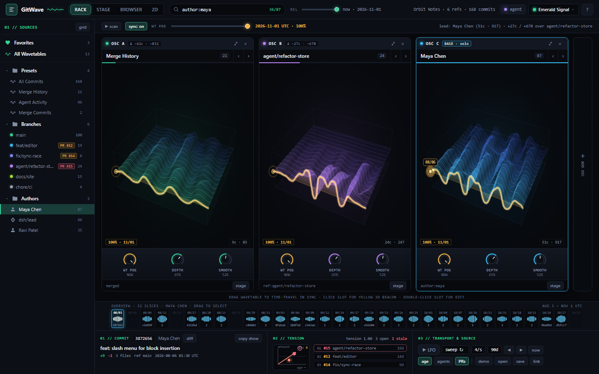
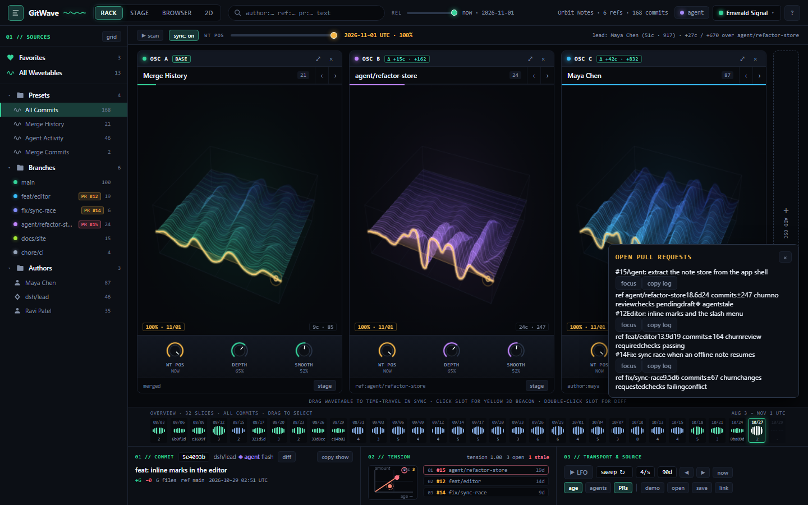
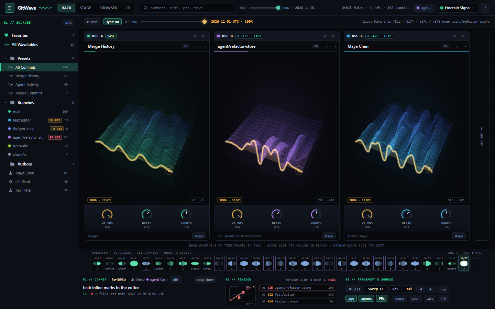

# GitWave

**Repositories as waveforms — every commit is a sample.**

GitWave is a single-file, offline, **read-only** history instrument. It renders a
repository window as thirty-two time slots, one monotone wave per ref, a version dial for
releases, an LFO transport that plays the history, and an amber *tension vector* for open
pull requests. Press **3D** and the **oscillator rack** opens: every saved filter is its own
small 3D wavetable — merge history, a branch, a person — and **open** expands one into a
large, fluid surface. **Find** morphs the surfaces to the commits you are looking for, and
**+** pins a search as a new module.

The 3D is not a chart. There is no 0–F ruler and no grid in the rack or the surface; the
register grammar belongs to the 2D view. The surfaces breathe, and a glowing amber frame
travels through each one as its wavetable position. The numbers live in the strip, the
cards and the stage bar (`POS 100%`).

**Live demo:** https://nextdaytre.github.io/GitWave/

**Or open `gitwave.html` locally in any browser.** No install, server or network. It works
from `file://`; the demo history is embedded.


## What you are looking at

| layer | meaning |
|---|---|
| **32 slots** | the window split into time slices — the wavetable frame |
| **2D wave height** | the slot's churn level, `0–15`, log-scaled and bounded (the register view) |
| **3D surface** | the same data as a wavetable: frames joined into a translucent sheet, no axis |
| **amber frame** | the travelling wavetable position through the 3D surface |
| **one wave per ref** | trunk (mint) and branches (cool hues); a wave exists only over its lifetime |
| **warm hues** | attention — amber = open/aging, coral = stale/conflict; never identity |
| **violet** | agent authorship (`◈` in the strip and the focus card) |
| **blue** | review state |
| **amber line** | the read head: where the window ends |
| **flags / diamonds** | releases / merge commits |
| **oscillator module** | one saved filter rendered as its own small 3D surface |
| **rack** | integration / branch / individual side by side, each a filter |
| **split** | open a module, then `+author` / `+ref` to add its children |
| **find** | a commit filter — `author:`, `ref:`, `pr:`, `agent`, `merged`, dates, text |

The questions it answers: **where am I in the versions, how much changed, what is waiting
for attention, and where did *this* person or change touch the year?**

## Gestures

| gesture | effect |
|---|---|
| wheel over the wave | travel one slot (Shift = a day, Ctrl/Cmd = zoom the span) |
| drag the wave | scrub the read head |
| click a slot / commit | focus it; the card names the exact commit |
| version dial | jump the read head to a release (`now` is the last stop) |
| click the amber tension vector | list the open pull requests |
| drag the pad | filter by age × size; wheel widens the filter |
| **`/` then type** | search commits; the surfaces and the strip morph |
| **Enter / Shift+Enter** | step to the next / previous match |
| **`D` or the 3D button** | open the oscillator rack |
| **click a module** | solo its filter (the strip follows) |
| **open / rack** | expand a module into the large surface / go back |
| **`+author` / `+ref`** | split the open filter into child modules |
| **`+` pin find** | save the current search as a new module |
| **agent** | `gitwave.html?fresh&spawn=author:maya&name=Maya` spawns a module from a filter |
| `Space` | play / pause the LFO transport |
| `←` / `→`, `Home` / `End` | older / newer / oldest / newest |
| `Alt+1…8` | focus a visible ref |
| `T` / `P` / `?` | theme / PR tray / help |

Everything is **read-only**. `copy show`, `copy log` and `copy link` put text on the
clipboard; nothing is executed and there is no network call.

## The demo

The bundled history is **Orbit Notes**, a deterministic fictional repository spanning
May–November 2026: 168 commits, six refs, three releases (`v0.9.0`, `v1.0.0`, `v1.1.0`),
two merges, five pull requests (two merged, two open, one draft) and 46 agent-authored
commits (22 on trunk, 24 on a draft branch). Snapshot time is fixed at
**2026-11-01 18:00 UTC**, so colours, links and screenshots never drift. See
[docs/DEMO.md](docs/DEMO.md).

Nine themes ship: **Emerald Signal** (`signal`, default), **Kilohearts Blue** (`kilohearts`),
**Neon Purple** (`velvet`), **Cyan Circuit** (`circuit`), **Acid Lime** (`acid`),
**Classic Orange** (`ember`), **Spectral Violet** (`spectral`), **BitWave Mint** (`bitwave`),
and **Graphite Mono** (`mono`).

| 3D oscillator rack (Emerald Signal) | 3D + 2D stage (Neon Purple) | Floating 3D browser (Kilohearts Blue) |
|---|---|---|
|  |  |  |

| Acid Lime rack | 2D multi-ref register | Classic Orange |
|---|---|---|
|  |  |  |

The rack is alive. The surfaces breathe and the amber wavetable-position frame travels
through each one; the live page runs the ambient at 30 fps (rack) and 60 fps (expanded).
This preview is ten frozen phases, compressed:



| search: author:maya (rack) | tension tray | agent lens |
|---|---|---|
|  |  |  |

## Build and verify

Node ≥ 23.6 for the build and tests (they use native TypeScript type-stripping).

```powershell
npm install
npm test                     # 82 DOM-free unit tests
npm run typecheck            # the DOM-free core
npm run build                # src/ -> gitwave.html (single file)
node tools/make-demo.mjs --check   # the fixture is current
node tools/verify.mjs        # headless Chrome: 60 checks + 17 screenshots
```

`tools/verify.mjs` reads the page's own hidden mirrors (`#gitwave-state`,
`#gitwave-selftest`) without a driver, proves a `#gw=` link restores a view (including the
3D and rack flags), asserts the strip is column-aligned to the curve (observed 0.01 px, in
2D **and** the expanded 3D), checks the opening rack, the search count and the agent spawn,
and captures all twelve documented screenshots (with `?static=1`, so the fluid surfaces are
frozen at a representative phase and the captures stay reproducible).

## Where the truth lives

| path | role |
|---|---|
| `src/core/model.ts` | parse, validate, freeze and index a `.gitwave` document |
| `src/core/samples.ts` | windows, 32 slots, the churn scale, filtered ref waves |
| `src/core/refs.ts` | lifetimes, pull-request derivation, age and tension |
| `src/core/search.ts` | the query language and the matching commits |
| `src/core/split.ts` | turning a filter into its author/ref children |
| `src/core/depth.ts` | the time-depth slice stack |
| `src/core/geometry.ts` | the one slot geometry shared by canvas and strip |
| `src/core/theme.ts` | the four palettes, the depth token and the colour contracts |
| `src/core/view.ts` | the only mutable thing: window, refs, focus, theme, motion, depth, query, modules |
| `src/core/share.ts` | the `#gw=` view codec |
| `src/app.ts` | the runtime context, the metric and the derived frame |
| `src/render/depth.js` | the 3D surface and the small module renderer |
| `src/render/rack.js` | the oscillator rack: modules, solo, open, pin |
| `src/render/` | canvas, strip, tension pad, readout |
| `src/ui/` | controls, find, legend, tray, help, keyboard, clipboard |
| `src/data/demo.gitwave.json` | the bundled deterministic history |
| `tools/make-demo.mjs` | the fixture generator (`--check` fails on drift) |
| `docs/DESIGN.md` | the visual contract |
| `docs/GIT-MODEL.md` | the data mapping, search grammar and schemas |
| `docs/DEMO.md` | the demo story and how to replace it |
| `AGENTS.md` | honest onboarding for agents working on GitWave |

## v0.4 scope

Shipped: the 2D instrument, the **fluid 3D oscillator rack**, the expanded surface with a
travelling wavetable frame, **visual search**, **author/ref splits**, the **agent spawn
URL**, four themes, the transport, the tension tray, import / save of `.gitwave`, `#gw=`
links, 79 tests, the headless verifier, twelve screenshots.

Next: the zero-dependency local-repo exporter (PRs = unmerged branches, optional `gh`
enrichment at export time), the refs cards view, and a compare (base/head) mode. Then the
agent bridge — `window.gitwave`, CLI, MCP, manifest. No Git writes, no network, no
telemetry.

## Sister, not fork

GitWave imports nothing from BitWave and shares no package. The monotone cubic spline, the
token discipline and the single-file build pattern are re-derived. BitWave remains the
register instrument; GitWave is the history instrument.
